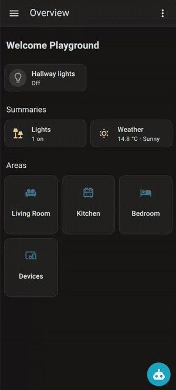
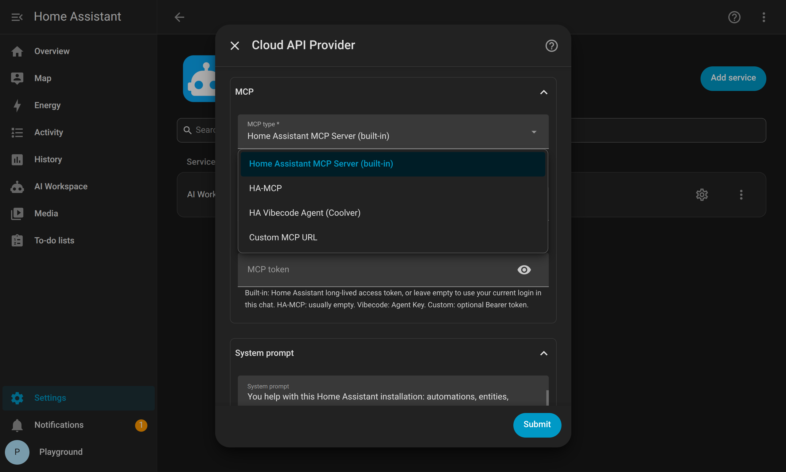
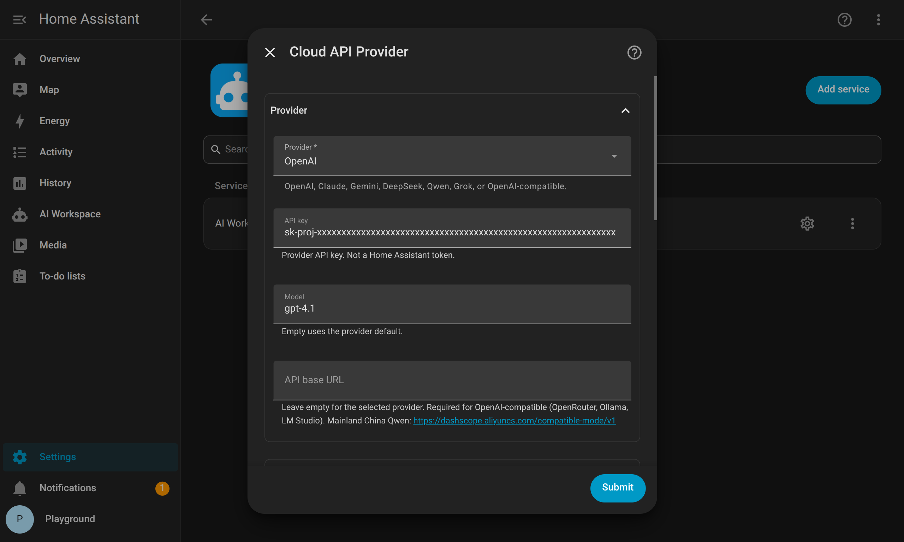
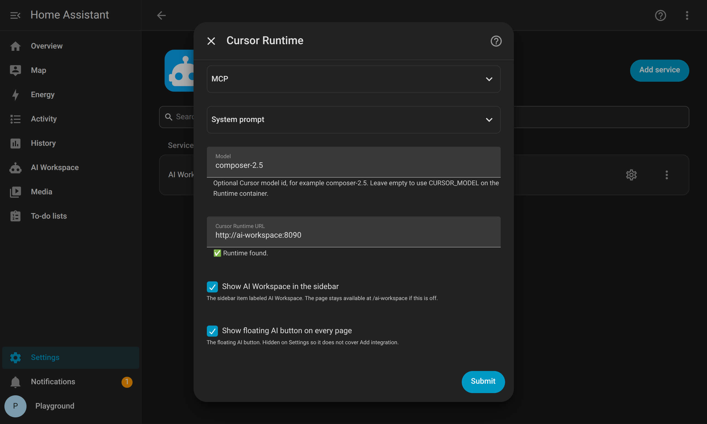
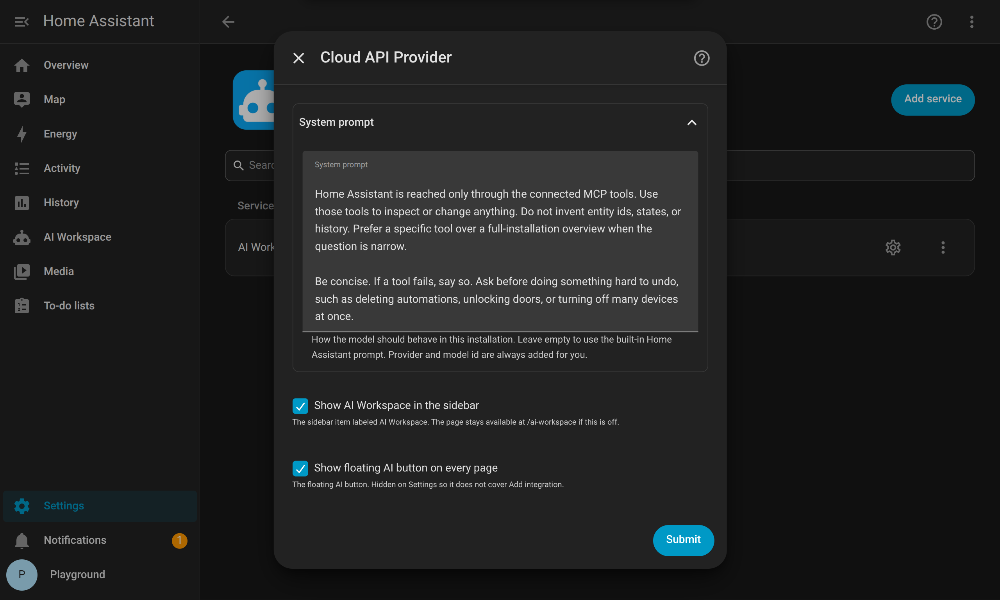

<p align="center">
  
</p>

<p align="center"><em>Use Cursor, Claude, or ChatGPT AI in Home Assistant from your couch.</em></p>

<p align="center">
  
</p>

# AI Workspace

An agent chat that can see **your** Home Assistant installation through MCP.

This is a HACS integration. The agent is a **cloud API** (OpenAI, Claude, Gemini, DeepSeek, Qwen, Grok, or OpenAI-compatible) or the **Cursor SDK Runtime** used in Home Assistant by the integration.

<p align="center">
  
</p>

## Requirements

- **Provider API key** (Cloud) or a **Cursor API key** (SDK Runtime)

Choose one MCP server, any of your choice.

- **Home Assistant MCP Server** (HA built-in)
- **[HA-MCP](https://github.com/homeassistant-ai/ha-mcp)**
- **[HA Vibecode Agent](https://github.com/Coolver/home-assistant-vibecode-agent)**
- A **custom MCP URL** if you already run something else

Keep the connect URL or Agent Key if it shows one — paste it only if auto-detect misses it later.

<p align="center">
  
</p>

---

## Option A: Cloud API Provider (Quick Setup)

Fastest path. No extra container. **OpenAI**, **Claude**, **Gemini**, **DeepSeek**, **Qwen**, **Grok**, or **OpenAI-compatible** (OpenRouter, LM Studio, Ollama at `http://127.0.0.1:11434/v1`, …). The model must support tool calls or it cannot drive MCP.

### 1. Install AI Workspace from HACS

[](https://my.home-assistant.io/redirect/hacs_repository/?owner=domdus&repository=ha-ai-workspace&category=integration)

Or **HACS → Integrations → ⋮ → Custom repositories** → `https://github.com/domdus/ha-ai-workspace` (category **Integration**) → **Download** → **Restart Home Assistant.**

### 2. Add the integration

**Settings → Devices & services → Add integration → AI Workspace → Cloud API Provider.**

- Provider key: paste the API key for the provider you picked.
- API base: leave empty unless you picked OpenAI-compatible (or Qwen in mainland China).
- MCP type: from Requirements. Leave MCP URL empty if it shows as detected.
- Save. Open **AI Workspace** (`/ai-workspace`).

<p align="center">
  
</p>

### 3. Start using it

Open **AI Workspace** (`/ai-workspace`) and ask: `List my automations.`

---

## Option B: Cursor AI (Advanced)

This integration works with **Cursor AI** using the SDK, without the desktop IDE:
MCP tools, multi-step work, spawn and resume agents. Headless — no editor, no Composer UI.

Install AI Workspace from HACS first ([step 1](#1-install-ai-workspace-from-hacs)). Then install the **Cursor SDK Runtime** once, for the Home Assistant you run.

<p align="center">
  
</p>

### Home Assistant OS / Supervised (Add-on)

Add this repo to Apps and install **AI Workspace Runtime**:

[](https://my.home-assistant.io/redirect/supervisor_add_addon_repository/?repository_url=https%3A%2F%2Fgithub.com%2Fdomdus%2Fha-ai-workspace)

Paste the Cursor API key on the app and **Start**. Leave Runtime URL empty. It is auto-detected once the app is running.

Home Assistant 2026.2 renamed “Add-ons” to “Apps”.

### Home Assistant Container (Docker)

If Home Assistant runs in Docker, without the Supervisor - it needs one extra container, `cursor-sdk`, next to Home Assistant.

There is no public ready-made image to download. The compose file builds it from `ai_workspace/Dockerfile` in this repo: A Debian with the Cursor SDK installed. Paste your Cursor API key from [Cursor Dashboard → Integrations](https://cursor.com/dashboard/integrations) into the compose file below (same file as [`docker-compose.runtime.yml`](docker-compose.runtime.yml)):

```yaml
name: ai-workspace-runtime

services:
  cursor-sdk:
    container_name: cursor-sdk
    build: ./ai_workspace
    image: cursor-sdk
    network_mode: host
    environment:
      CURSOR_API_KEY: "paste-your-cursor-api-key"
      CURSOR_MODEL: composer-2.5
      AUTH_MODE: ingress
      DATA_DIR: /data
      HOST: "127.0.0.1"
      PORT: "8090"
    volumes:
      - ai-workspace-data:/data
    restart: unless-stopped

volumes:
  ai-workspace-data:
```

Start that project the same way you start Home Assistant.

**Host network** (`network_mode: host` in the file above). Same as a typical Home Assistant Container. MCP at `127.0.0.1` on this machine works. `HOST: 127.0.0.1` keeps **8090** off the LAN.

**Bridge network** is Docker's default when you leave out `network_mode: host`. Inside the container, `127.0.0.1` is the container, not Home Assistant, so loopback MCP is rewritten to the Docker host. Drop `network_mode` and use:

```yaml
    ports:
      - "127.0.0.1:8090:8090"
    extra_hosts:
      - "host.docker.internal:host-gateway"
    environment:
      HOST: "0.0.0.0"
      REWRITE_LOOPBACK_HOST: host.docker.internal
```

`127.0.0.1:8090:8090` still keeps **8090** off the LAN. If Home Assistant is another container on that same bridge, set the Runtime URL to `http://cursor-sdk:8090`.

### Add the integration

After the Runtime is up and running: **Settings → Devices & services → Add integration → AI Workspace → Cursor Runtime app.**

- Runtime URL: leave empty (it should find `http://127.0.0.1:8090`).
- Model: `composer-2.5`, `grok-4`, `gpt-4.1`, `claude-sonnet-4-5` (or leave empty to use `CURSOR_MODEL` on the container).
- MCP type: from Requirements. Leave MCP URL empty if it shows as detected.
- Save. Open **AI Workspace** (`/ai-workspace`).

## System Prompt

**Settings → Devices & services → AI Workspace → Configure**

This is the standing instruction for the assistant. Use it for your own needs: how you name rooms, which automations to leave alone, how short answers should be, or any other strategy or requirement. What you write here replaces the built-in prompt. Leave the field empty to keep that built-in text, which covers helping with this Home Assistant and asking before it changes the house. The same text is used for Cloud API and Cursor Runtime.

It does not control Home Assistant edit links. Those are added on every reply, so automations, entities, helpers, and devices stay tappable.

<p align="center">
  
</p>


## Options

| Option | What it does |
|---|---|
| **Chat Backend** | **Cloud API Provider** or **Cursor SDK Runtime** |
| **Provider** | Cloud: OpenAI, Claude, Gemini, DeepSeek, Qwen, Grok, or OpenAI-compatible; API key; optional model and base URL. Cursor: Model overrides `CURSOR_MODEL` on the Runtime when set |
| **MCP type** | Built-in MCP Server, HA-MCP, HA Vibecode Agent, or custom URL |
| **MCP URL** | Empty uses auto-detect. Paste the HA-MCP webhook / custom URL only if needed |
| **MCP token** | Built-in: long-lived token or empty for this login. HA-MCP: usually empty. Vibecode: Agent Key |
| **System prompt** | Behaviour above. Empty uses the built-in prompt |
| **Show floating AI button on every page** | Bottom-right robot icon. Hidden on Settings |
| **Show dictate button** | Microphone in the prompt. On by default. Browsers allow it only over https://. |
| **Show AI Workspace in the sidebar** | Sidebar item. `/ai-workspace` still works if this is off |

MCP is set on this form for both backends and sent to the SDK Runtime on each chat. The Cursor API key stays on the Runtime.

## Remove it

1. **Settings → Devices & services → AI Workspace → Delete.**
2. HACS → AI Workspace → **Remove**, restart.
3. Runtime: remove the **app**, or `docker compose down` in the Runtime compose folder (`docker rm -f cursor-sdk` if an old container remains).
