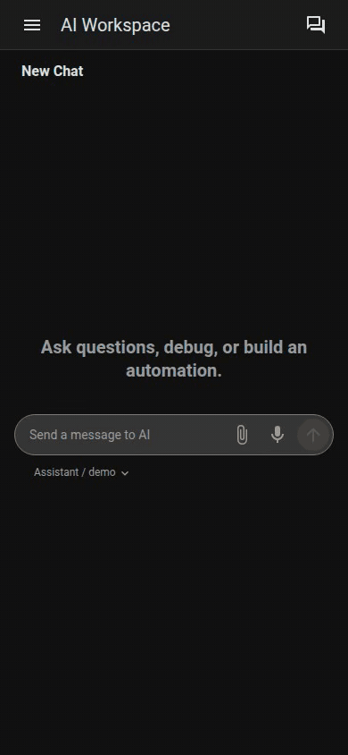
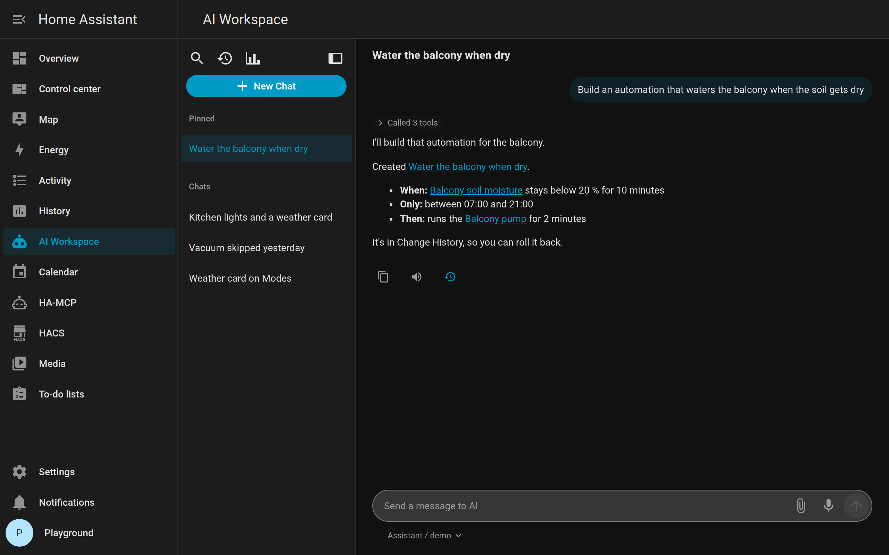
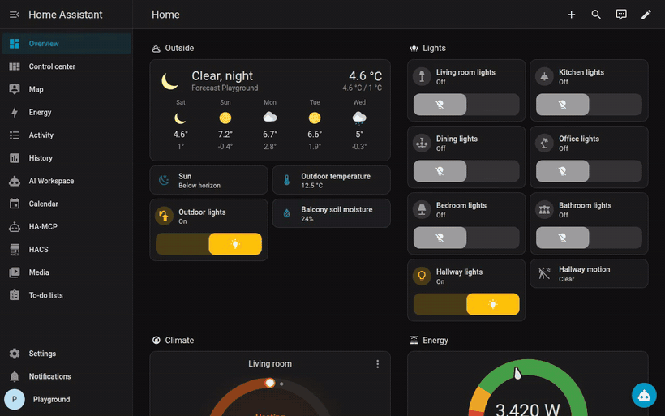
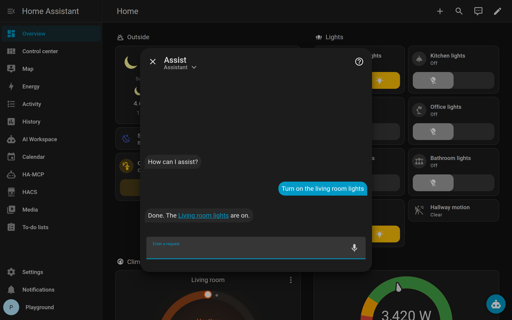
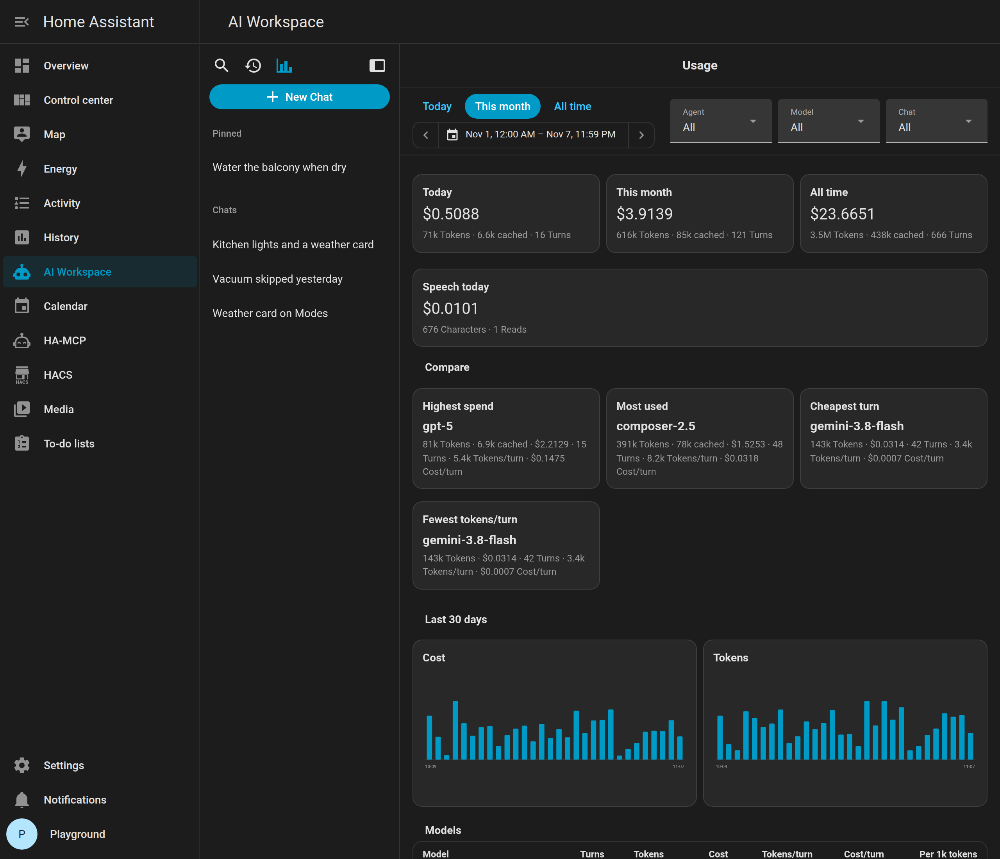
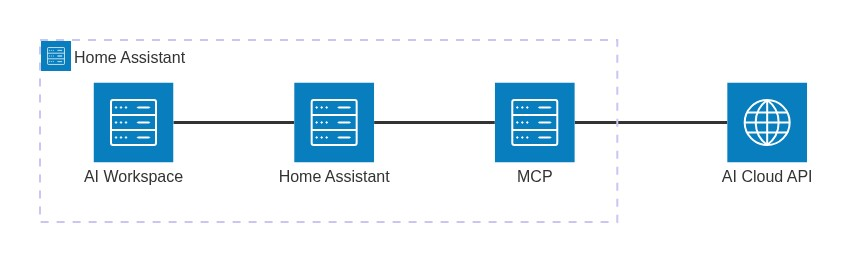
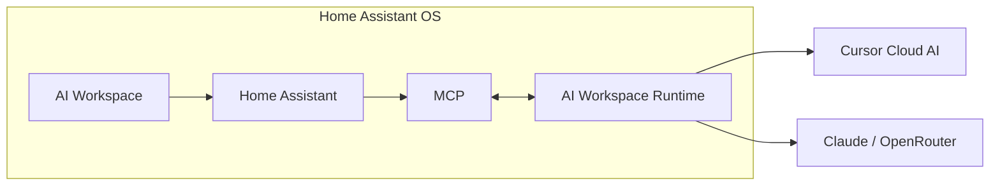
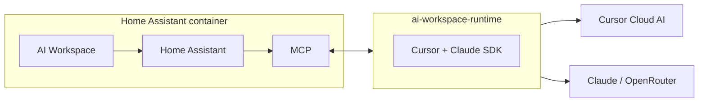
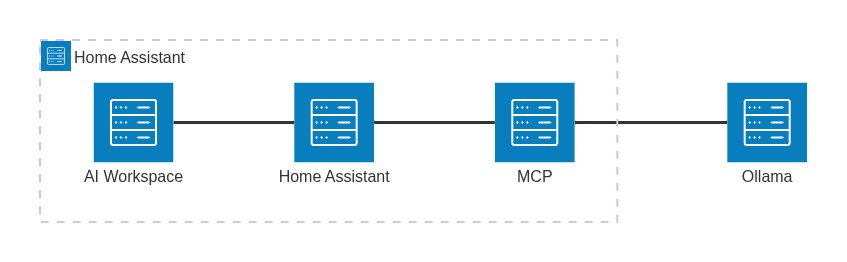

<div align="center">

# AI Workspace
 <em>Build your Home Assistant from the couch.</em>

  


</div>

Talk to an AI inside Home Assistant. Ask it to list your lights, write an automation, or fix a dashboard. Plug in the MCP server you like — that's how it actually sees the house.

You stay in Home Assistant. No Claude Desktop, no Cursor app, no VS Code. Cursor, OpenAI, Claude, Gemini, DeepSeek, Qwen, Grok, or any OpenAI-compatible model — same chat.

<p align="center">
  
</p>

What it can do depends on that MCP. Here's what you get:

- A polished agent chat — replies stream in as they come
- Drop in a screenshot or a YAML file
- Tap a name and you're in the device, the automation, the dashboard
- Pin the chats you'll want later. Every write has a **Change History**, so you can **Rollback** if you don't like it. Automations, scripts, and scenes also land as YAML under `config/ai_workspace/changes/` if Home Assistant will not start ([restore by hand](docs/mcp.md#if-home-assistant-will-not-start))
- See roughly what a chat cost — per agent, per model. Optional sensors if you want that on a dashboard
- Switch agents mid-thread, and optionally the model too. Each chat remembers what it was using
- Web search and page fetch per agent, if you allow it (off by default)
- The MCP of your choice: [HA-MCP](https://github.com/homeassistant-ai/ha-mcp), the [built-in server](https://www.home-assistant.io/integrations/mcp_server/), or one you already run
- Chat from any page — optional floating button
- Talk and listen, if you want (HTTPS for the mic)
- Same agents in Assist — conversation, listening, speaking already wired



You're on the dashboard. Ask anyway.

  
<p align="center">
  
</p>

Each agent can also show up in Home Assistant's Assist dialog. AI Workspace creates that pipeline for you, so you can talk to **Cursor AI** (or another agent) from the microphone as well.

OpenAI, OpenRouter, and OpenAI-compatible agents can listen and speak with the same key you already pasted (on by default). Gemini can too, with Google's own voices — existing Gemini agents stay quiet until you turn that on. New Assist pipelines pick those voices up; you can still change them under **Settings → Voice assistants**. Cursor, Claude, Azure, and Ollama have no voice of their own, so they use something like Piper.

Coral, Echo, and the other OpenAI-style voices speak **German, French, and many other languages**. They follow the language of the reply.



The **Usage** page is the honest bit: what you spent, which model, which day. So you know what's actually worth it. More in [Cost and tokens](docs/cost.md).



## Requirements

- Home Assistant **2025.12** or newer
- A **provider API key** from that provider's API console (⚠️ not a ChatGPT or Claude.ai plan; usually paid API credits), a local **Ollama** server, or credentials for **AI Workspace Runtime** — a **Cursor API key** and/or **Claude SDK** auth (Claude Plan, OpenRouter, or Anthropic API on the runtime)

You also need an MCP server:

- [Home Assistant MCP Server](https://www.home-assistant.io/integrations/mcp_server/) (built into Home Assistant)
- [HA-MCP](https://github.com/homeassistant-ai/ha-mcp) (highly recommended)
- [HA Vibecode Agent](https://github.com/Coolver/home-assistant-vibecode-agent)
- Any other or **custom MCP URL** if you already run something else

---


## Cloud AI (quick start)

Add an agent for **OpenAI**, **Claude**, **Gemini**, **DeepSeek**, **Qwen**, **Grok**, **OpenRouter**, **Azure OpenAI**, **local Ollama**, or **OpenAI-compatible** (LM Studio and others). The model has to be able to call tools, or it cannot see your house. If that provider is already set up in Home Assistant, the form can copy its key.

You type in **AI Workspace**. The reply comes from that provider. **MCP** is how the model reaches Home Assistant.

⚠️ A ChatGPT or Claude.ai subscription does not include this. OpenAI and Claude need API credits on [platform.openai.com](https://platform.openai.com) and [console.anthropic.com](https://console.anthropic.com). Gemini has a free API tier with limits. OpenRouter is its own credit balance (it then pays the model behind it). Ollama stays on your hardware and does not bill a cloud API.



### 1. Install AI Workspace from HACS

[](https://my.home-assistant.io/redirect/hacs_repository/?owner=domdus&repository=ha-ai-workspace&category=integration)

Until it is in the default HACS store, add it as a custom repository: **HACS → Integrations → ⋮ → Custom repositories** → `https://github.com/domdus/ha-ai-workspace` (category **Integration**) → **Download** → **Restart Home Assistant**.

**Manual install (no HACS):** copy `custom_components/ai_workspace/` from this repository into your Home Assistant `config/custom_components/` directory, restart, and add the integration as below.

### 2. Add the integration

**Settings → Devices & services → Add integration → AI Workspace.**

- **MCP type:** one from [Requirements](#requirements). Leave the MCP URL empty if it shows as detected.
- Save. Home Assistant then asks for the first **agent**.
- Pick the provider. Paste the key, use **Get an API key** under the field, or choose **Copy key from** when OpenRouter, OpenAI, Claude, Gemini, Ollama, or Azure is already set up. The key is checked before it is saved.
- **Model:** the list comes from the provider with your key, so new models show up without an update. You can still type any model id.
- Each agent also has **Allow internet** (off by default) and, under **Advanced**, **Save tokens**. See [Agent settings](docs/settings.md#agent-settings).
- Add more agents later with **Add agent** on the AI Workspace entry. The chat shows an agent picker when more than one is set up. **Configure** sets the **Default agent** for new chats and can add a **model switcher** next to the agent picker.

You can also put the same settings in `configuration.yaml`. See [YAML configuration](docs/settings.md#yaml-configuration).


### 3. Try it

Open **AI Workspace** (`/ai-workspace`) and ask things like:

- List my automations
- Why is the hallway light on?
- Create an automation that turns on the lights when there is motion
- Add a card on Overview for the outdoor temperature

---


## AI Workspace Runtime (Cursor and Claude SDK)

Want **Cursor**'s own agent in that same chat, without opening the Cursor app? It can work through a longer task and pick up the thread next time. There is still no editor: you only chat in Home Assistant. From 1.6.0 the same sidecar also runs **Claude SDK** agents ([Claude on the runtime](docs/claude-runtime.md): OpenRouter Agent SDK, Claude Plan OAuth, or Anthropic API).

If you only want Claude or GPT via a simple API key in Home Assistant, skip this and use [Cloud AI](#cloud-ai-quick-start) above — that is **Claude (Anthropic)** and other cloud providers, not the runtime.

**Notice**
> You can get some Cursor models with one [OpenRouter](https://openrouter.ai) key. No AI Workspace Runtime to install that way. Add that under [Cloud AI](#cloud-ai-quick-start).


Cursor's own **Composer** and Tab completion are not on OpenRouter. If the Cursor desktop app uses OpenRouter, that is a Cursor setting, not AI Workspace. See [OpenRouter's Cursor notes](https://openrouter.ai/docs/cookbook/coding-agents/cursor-integration).


Install AI Workspace from HACS first ([step 1](#1-install-ai-workspace-from-hacs)).

### Option A: Home Assistant OS / Supervised (App)

The **AI Workspace Runtime** app runs on the same machine as Home Assistant — **Cursor** (Composer, Grok, Cursor API key) and **Claude SDK** in one place.



*AI Workspace, Home Assistant, MCP, and the runtime app inside Home Assistant OS; Cursor Cloud AI and Claude / OpenRouter outside.*

Add this repository to Apps and install **AI Workspace Runtime**:


For **Cursor**, paste the Cursor API key on the app and **Start** it. For **Claude SDK**, set OpenRouter, Claude Plan OAuth, or Anthropic API on the app instead ([details](docs/claude-runtime.md)). Leave **Runtime URL** on the integration empty; it is detected once the app runs. The integration also creates the shared [runtime token](#runtime-token) and writes it to the app for you.

Home Assistant 2026.2 renamed "Add-ons" to "Apps".

### Option B: Home Assistant Container (Docker)

If Home Assistant is a Docker container (no Supervisor), run the **`ai-workspace-runtime`** container beside it. Home Assistant talks to that runtime; the runtime runs **Cursor** and **Claude SDK**, talks to MCP, and reaches Cursor Cloud AI or Claude / OpenRouter as needed.



*Home Assistant in one container; **ai-workspace-runtime** beside it with Cursor and Claude SDK; cloud arrows as above.*

Paste your Cursor API key from [Cursor Dashboard → Integrations](https://cursor.com/dashboard/integrations) into [docker-compose.runtime.yml](docker-compose.runtime.yml) when you use Cursor agents. For Claude SDK, set `OPENROUTER_API_KEY`, `CLAUDE_CODE_OAUTH_TOKEN`, or `ANTHROPIC_API_KEY` on the container ([details](docs/claude-runtime.md)); the compose file already lists them as comments.

```yaml
name: ai-workspace-runtime

services:
  ai-workspace-runtime:
    container_name: ai-workspace-runtime
    image: ghcr.io/domdus/ha-ai-workspace-runtime:latest
    build: ./ai_workspace
    network_mode: host
    environment:
      CURSOR_API_KEY: "paste-your-cursor-api-key"
      CURSOR_MODEL: composer-2.5
      RUNTIME_TOKEN: ""
      AUTH_MODE: ingress
      DATA_DIR: /data
      HOST: "127.0.0.1"
      PORT: "8090"
    volumes:
      - ai-workspace-data:/data
    restart: unless-stopped

volumes:
  ai-workspace-data:
```

```bash
docker compose -f docker-compose.runtime.yml up -d
```

That pulls the image from [GHCR](https://github.com/domdus/ha-ai-workspace/pkgs/container/ha-ai-workspace-runtime) (`linux/amd64` and `linux/arm64`). To build from this repository instead (`ai_workspace/Dockerfile`):

```bash
docker compose -f docker-compose.runtime.yml up -d --build
```

**Host network** (`network_mode: host`, as above) matches a typical Home Assistant Container. The runtime reaches MCP at `127.0.0.1` on this machine, and `HOST: 127.0.0.1` keeps port **8090** off your network. The runtime token is optional here.

Running Docker's default bridge network instead, giving the agent a folder of files, or letting it work in a git repository: see [AI Workspace Runtime in Docker](docs/cursor-runtime.md).

### Runtime token

The integration and the runtime share a token, and every chat request carries it.

- **App (Home Assistant OS):** nothing to do. The integration generates the token, stores it on the app, and restarts the app once.
- **Docker:** generate one, for example with `openssl rand -hex 32`. Put it in `RUNTIME_TOKEN` on the container and in **Runtime token** on the Cursor or Claude SDK agent.


### Add the integration (Options A and B)

After the runtime is running: **Settings → Devices & services → Add integration → AI Workspace.**

- **MCP type:** one from [Requirements](#requirements). Leave the MCP URL empty if it shows as detected.
- Save. Home Assistant then asks for the first agent. Choose **Cursor**.
- **Runtime address:** leave empty unless the form does not show **Runtime found**. It is filled only when this Home Assistant can reach the runtime (`http://127.0.0.1:8090` or the app). Do not paste a Docker hostname unless Home Assistant can reach that container.
- **Model:** the list shows what your Cursor account can use (Composer, Claude, GPT, Gemini, Grok, and more). Or type a model name, for example `composer-2.5`. Leave it empty to use `CURSOR_MODEL` from the runtime.
- **Allow internet** is off by default: Cursor then has no web search, page fetch, or shell, so it cannot reach the internet from the runtime. Turn it on if you want Cursor to look things up. See [Internet access](docs/privacy.md#internet-access).
- Paste the Cursor API key, unless the runtime already has one.
- Open **AI Workspace** (`/ai-workspace`).


## Local AI (Ollama)

Same as Cloud AI, but the model runs in your house (**Ollama** or LM Studio). Nothing is sent to a cloud API. The model still has to be able to call tools.

Pick a model that can use tools (Ollama lists them with the *tools* tag), and give Ollama a context window of at least 16,384 tokens (`OLLAMA_CONTEXT_LENGTH`). AI Workspace asks Ollama about both. If the model cannot use tools, or its window is too small, the agent switches to chat only and says so once in the chat: it can answer questions, but it cannot check or change the house. A slow machine gets up to 10 minutes per answer. See [Save tokens](docs/cost.md#save-tokens).

Install as in [Cloud AI](#cloud-ai-quick-start). Pick **Ollama** and point the API Base URL at your Ollama server.



## More in the docs

The [docs](docs/README.md) go further once you are up and running:

- [Settings](docs/settings.md) — every option, what it does, and why it matters
- [Cost and tokens](docs/cost.md) — Usage page, where prices come from, token modes, and prompt cache
- [AI Workspace Runtime in Docker](docs/cursor-runtime.md) — bridge network, files on disk, and git
- [Privacy](docs/privacy.md) — what leaves the house, who can chat, Assist satellites
- [MCP and Change History](docs/mcp.md) — connections, large tool results, the change log, and restoring YAML by hand if Home Assistant will not start
- [Troubleshooting](docs/troubleshooting.md) — common errors and how to remove AI Workspace

## Community

- **[GitHub Discussions](https://github.com/domdus/ha-ai-workspace/discussions):** ask questions and share ideas
- **[Issue Tracker](https://github.com/domdus/ha-ai-workspace/issues):** report bugs, request features, or suggest tool behavior improvements

## Contributing

Open an issue or send a pull request from a fork. The chat is `custom_components/ai_workspace/`. The runtime (Cursor + Claude SDK) lives in `ai_workspace/`.

