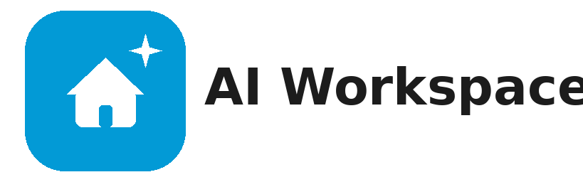

<p align="center">
  
</p>

<p align="center"><em>Use Cursor, Claude, or ChatGPT AI in Home Assistant from your couch.</em></p>

---

# AI Workspace

An agent chat that can see **your** Home Assistant installation through MCP.

The UI is a HACS integration. The agent is a **cloud API** (OpenAI or Claude) or the **Cursor SDK Runtime** used in Home Assistant by the integration.

## Requirements

Any **MCP server** the agent can call. AI Workspace does not bundle Home Assistant access. Common options:

- **Home Assistant MCP Server** (built-in) — **Settings → Devices & services → Add integration → MCP Server**
- **[HA-MCP](https://github.com/homeassistant-ai/ha-mcp)**
- **[HA Vibecode Agent](https://github.com/Coolver/home-assistant-vibecode-agent)**
- A **custom MCP URL** if you already run something else

Leave it running. Keep the connect URL or Agent Key if it shows one — paste it only if auto-detect misses it later.

You also need [HACS](https://hacs.xyz) and either an **OpenAI / Claude API key** (Cloud) or a **Cursor API key** (SDK Runtime).

## Cloud API (OpenAI or Claude)

Fastest path. No extra container.

### 1. Install AI Workspace from HACS

[](https://my.home-assistant.io/redirect/hacs_repository/?owner=domdus&repository=ha-ai-workspace&category=integration)

Or **HACS → Integrations → ⋮ → Custom repositories** → `https://github.com/domdus/ha-ai-workspace` (category **Integration**) → **Download** → **Restart Home Assistant.**

### 2. Add the integration

**Settings → Devices & services → Add integration → AI Workspace → Cloud API Provider.**

OpenAI or Claude key, MCP type from Requirements. Leave MCP URL empty if it shows as detected. Save.

### 3. Start using it

Open **AI Workspace** (`/ai-workspace`) and ask: `List my lights and one automation.`

## Cursor SDK Runtime

Same agent as **Cursor IDE**, without the desktop: MCP tools, multi-step work, spawn and resume agents. Headless — no editor, no Composer UI — used in Home Assistant by the integration.

### Home Assistant OS / Supervised

Add this repo to Apps and install **AI Workspace Runtime**:

[](https://my.home-assistant.io/redirect/supervisor_add_addon_repository/?repository_url=https%3A%2F%2Fgithub.com%2Fdomdus%2Fha-ai-workspace)

Paste the Cursor API key on the app, **Start**, then **Add integration → Cursor Runtime app**. Runtime URL is filled in when the app is running.

Home Assistant 2026.2 renamed “Add-ons” to “Apps”.

### Home Assistant Container

Official Docker image (no Apps store). Same Docker **host** as Home Assistant. Copy [`docker-compose.runtime.yml`](docker-compose.runtime.yml), replace the Cursor API key ([Cursor Dashboard → Integrations](https://cursor.com/dashboard/integrations) — not a Home Assistant token), then `docker compose up -d`.

```bash
mkdir -p ai-workspace-runtime && cd ai-workspace-runtime
curl -fsSL -o docker-compose.yml https://raw.githubusercontent.com/domdus/ha-ai-workspace/main/docker-compose.runtime.yml
```

Edit `CURSOR_API_KEY`, then:

```yaml
# docker-compose.yml  — also in this repo as docker-compose.runtime.yml
name: ai-workspace-runtime

services:
  cursor-sdk:
    container_name: cursor-sdk
    image: ghcr.io/domdus/ha-ai-workspace-runtime:latest
    extra_hosts:
      - "host.docker.internal:host-gateway"
    ports:
      - "127.0.0.1:8090:8090"
    environment:
      CURSOR_API_KEY: "paste-your-cursor-api-key"
      CURSOR_MODEL: composer-2.5
      AUTH_MODE: ingress
      DATA_DIR: /data
      HOST: "0.0.0.0"
      PORT: "8090"
      REWRITE_LOOPBACK_HOST: host.docker.internal
    volumes:
      - ai-workspace-data:/data
    restart: unless-stopped

volumes:
  ai-workspace-data:
```

```bash
docker compose up -d
```

No host network (Container Manager can stop this). Port **8090** is on `127.0.0.1` only — not the LAN. Check: `curl -sS http://127.0.0.1:8090/api/health`.

If an old `cursor-sdk` container is still running, `docker rm -f cursor-sdk` first.

Then **Settings → Devices & services → Add integration → AI Workspace → Cursor Runtime app.**

- Runtime URL: leave empty (it should find `http://127.0.0.1:8090`).
- MCP type: from Requirements. Leave MCP URL empty if it shows as detected.
- Save. Open **AI Workspace** (`/ai-workspace`).

## Configure later

**Settings → Devices & services → AI Workspace → Configure**

| Option | What it does |
|---|---|
| **Chat Backend** | **Cloud API Provider** or **Cursor SDK Runtime** |
| **Provider** | Cloud: OpenAI or Claude, API key, optional model. Cursor: optional model overrides `CURSOR_MODEL` |
| **MCP type** | Built-in MCP Server, HA-MCP, HA Vibecode Agent, or custom URL |
| **MCP URL** | Empty uses auto-detect. Paste the HA-MCP webhook / custom URL only if needed |
| **MCP token** | Built-in: long-lived token or empty for this login. HA-MCP: usually empty. Vibecode: Agent Key |
| **System prompt** | Cloud API behaviour. Empty uses the built-in prompt |
| **Show floating AI button on every page** | Bottom-right **AI**. Hidden on Settings |
| **Show AI Workspace in the sidebar** | Sidebar item. `/ai-workspace` still works if this is off |

MCP is set on this form for both backends and sent to the SDK Runtime on each chat. The Cursor API key stays on the Runtime.

## Remove it

1. **Settings → Devices & services → AI Workspace → Delete.**
2. HACS → AI Workspace → **Remove**, restart.
3. Runtime: remove the **app**, or `docker compose down` in the Runtime compose folder (`docker rm -f cursor-sdk` if an old container remains).
