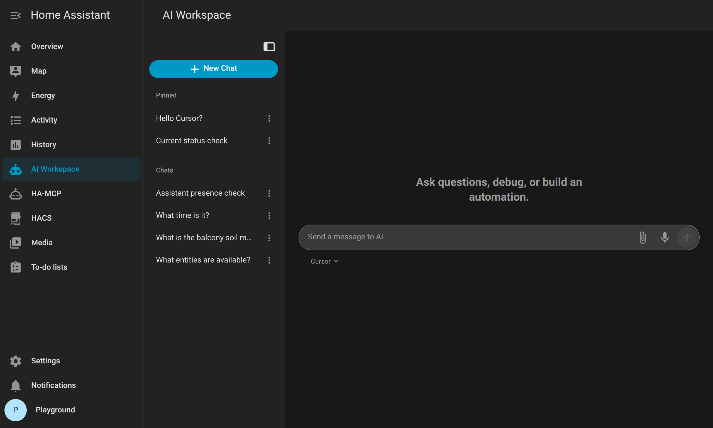

<p align="center">
  
</p>

<p align="center"><em>Use AI inside Home Assistant from your couch.</em></p>

<p align="center">
  <video src="https://github.com/user-attachments/assets/40926258-222b-42b4-a8bc-8c78308d4db9" width="300" autoplay loop muted playsinline></video>
</p>

# AI Workspace

An agent chat that can see **your** Home Assistant installation through MCP.

This is a HACS integration. The agent is a **cloud API** (OpenAI, Claude, Gemini, DeepSeek, Qwen, Grok, or OpenAI-compatible) or Cursor AI via the **Cursor SDK Runtime** used in Home Assistant by the integration.

What the agent can do relies on the MCP server you connect. Automations, dashboards, history, and devices are that server's tools. Home Assistant applies each change itself, so a new automation or dashboard is there without a restart. Access stays on that MCP connection, and the tools stay the ones Home Assistant already speaks. That is safer and more reliable than a second tool set maintained beside Home Assistant.

<p align="center">
  
</p>

## Requirements

- **Provider API key** (Cloud) or a **Cursor API key** (SDK Runtime)

Start with one MCP server. You can add more later, and the assistant uses all of them in the same chat.

- **Home Assistant MCP Server** (HA built-in)
- **[HA-MCP](https://github.com/homeassistant-ai/ha-mcp)** — install the [custom component](https://github.com/homeassistant-ai/ha-mcp-integration) and its connect URL is picked up from that entry. Docker and the app are the other ways to run the same server.
- **[HA Vibecode Agent](https://github.com/Coolver/home-assistant-vibecode-agent)**
- A **custom MCP URL** if you already run something else

Keep the connect URL or Agent Key if it shows one — paste it only if auto-detect misses it later.

---

## Option A: Cloud API Provider (Quick Setup)

Fastest path. No extra container. Add **AI Workspace** once. It adds an **AI Agents** device beside it. Add an agent there for **OpenAI**, **Claude**, **Gemini**, **DeepSeek**, **Qwen**, **Grok**, **OpenRouter**, **Azure OpenAI**, **local Ollama**, or **OpenAI-compatible** (LM Studio and others). The model must support tool calls or it cannot drive MCP. If that provider is already configured in Home Assistant, the agent form can copy its key.

### 1. Install AI Workspace from HACS

[](https://my.home-assistant.io/redirect/hacs_repository/?owner=domdus&repository=ha-ai-workspace&category=integration)

Or **HACS → Integrations → ⋮ → Custom repositories** → `https://github.com/domdus/ha-ai-workspace` (category **Integration**) → **Download** → **Restart Home Assistant.**

### 2. Add the integration

**Settings → Devices & services → Add integration → AI Workspace.**

- MCP type: from Requirements. Leave MCP URL empty if it shows as detected.
- Save. Home Assistant then asks for the first **agent**.
- Pick the provider. Paste the key, or choose **Copy key from** when OpenRouter, OpenAI, Claude, Gemini, or Ollama is already set up.
- Add more agents on the **AI Agents** device. The chat shows a provider list when more than one is set up.
- Open **AI Workspace** (`/ai-workspace`).

### 3. Start using it

Open **AI Workspace** (`/ai-workspace`) and ask: `List my automations.`

---

## Option B: Cursor AI (Advanced)

This integration works with **Cursor AI** using the SDK, without the desktop IDE:
MCP tools, multi-step work, spawn and resume agents. Headless — no editor, no Composer UI.

Install AI Workspace from HACS first ([step 1](#1-install-ai-workspace-from-hacs)). Then install the **Cursor SDK Runtime** once, for the Home Assistant you run.

### Home Assistant OS / Supervised (Add-on)

Add this repo to Apps and install **AI Workspace Runtime**:

[](https://my.home-assistant.io/redirect/supervisor_add_addon_repository/?repository_url=https%3A%2F%2Fgithub.com%2Fdomdus%2Fha-ai-workspace)

Paste the Cursor API key on the app and **Start**. Leave Runtime URL empty. It is auto-detected once the app is running.

Home Assistant 2026.2 renamed “Add-ons” to “Apps”.

### Home Assistant Container (Docker)

If Home Assistant runs in Docker, without the Supervisor - it needs one extra container, `cursor-sdk`, next to Home Assistant.

There is no public ready-made image to download. The compose file builds it from `ai_workspace/Dockerfile` in this repo: A Debian with the Cursor SDK installed. Paste your Cursor API key from [Cursor Dashboard → Integrations](https://cursor.com/dashboard/integrations) into the compose file below (same file as [`docker-compose.runtime.yml`](docker-compose.runtime.yml)):

```yaml
name: ai-workspace-runtime

services:
  cursor-sdk:
    container_name: cursor-sdk
    build: ./ai_workspace
    image: cursor-sdk
    network_mode: host
    environment:
      CURSOR_API_KEY: "paste-your-cursor-api-key"
      CURSOR_MODEL: composer-2.5
      AUTH_MODE: ingress
      DATA_DIR: /data
      HOST: "127.0.0.1"
      PORT: "8090"
    volumes:
      - ai-workspace-data:/data
    restart: unless-stopped

volumes:
  ai-workspace-data:
```

Start that project the same way you start Home Assistant.

**Host network** (`network_mode: host` in the file above). Same as a typical Home Assistant Container. MCP at `127.0.0.1` on this machine works. `HOST: 127.0.0.1` keeps **8090** off the LAN.

**Bridge network** is Docker's default when you leave out `network_mode: host`. Inside the container, `127.0.0.1` is the container, not Home Assistant, so loopback MCP is rewritten to the Docker host. Drop `network_mode` and use:

```yaml
    ports:
      - "127.0.0.1:8090:8090"
    extra_hosts:
      - "host.docker.internal:host-gateway"
    environment:
      HOST: "0.0.0.0"
      REWRITE_LOOPBACK_HOST: host.docker.internal
```

`127.0.0.1:8090:8090` still keeps **8090** off the LAN. If Home Assistant is another container on that same bridge, set the Runtime URL to `http://cursor-sdk:8090`.

### Add the integration

After the Runtime is up and running: **Settings → Devices & services → Add integration → AI Workspace.**

- Runtime URL: leave empty (it should find `http://127.0.0.1:8090`).
- MCP type: from Requirements. Leave MCP URL empty if it shows as detected.
- Save. Home Assistant then asks for the first agent. Choose **Cursor**.
- Model: `composer-2.5`, `grok-4`, `gpt-4.1`, `claude-sonnet-4-5` (or leave empty to use `CURSOR_MODEL` on the container).
- Paste the Cursor API key, unless the Runtime already has one.
- Open **AI Workspace** (`/ai-workspace`). More agents are added with **Add agent**.

## More than one connection

The first connection is this Home Assistant. After setup it is a row on the **AI Workspace** device, with the same shape as any connection you add later. When the assistant should also reach another MCP server, such as a website, a CMS, or another tool you already run, add that row too.

**Settings → Devices & services → AI Workspace.** Use **Add connection** for another MCP server, and **Add agent** for another provider. Give a connection a short name and its address. Open a row to change it, or remove it from that row. The assistant can use every connection in one chat, whether the agent is a cloud model or Cursor.

## System Prompt

**Settings → Devices & services → AI Workspace → Configure**

This is the standing instruction for the assistant. Use it for your own needs: how you name rooms, which automations to leave alone, how short answers should be, or any other strategy or requirement. What you write here replaces the built-in prompt. Leave the field empty to keep that built-in text, which covers helping with this Home Assistant and asking before it changes the house. The same text is used for Cloud API and Cursor Runtime.

It does not control Home Assistant edit links. Those are added on every reply, so automations, entities, helpers, and devices stay tappable.

## Large listings

A tool that sends back the whole house is shortened before the model reads it. The entities are grouped by area, as ids only, and the model can ask again for one area or one entity to load states and attributes. A shorter list keeps each entity's state and drops the bulky attributes. One entity, one room, or one automation still arrives whole. What the model receives is always valid JSON. Nothing is cut off in the middle of an object. This is automatic for Cloud API and Cursor Runtime.

## Options

| Option | What it does |
|---|---|
| **AI Workspace** | Shared chat settings, and one row per MCP connection. **Add connection** puts another row here |
| **AI Agents** | One row per Cursor, OpenAI, Claude, Gemini, OpenRouter, Ollama, Azure, or other provider. **Add agent** puts another row here. Effort is Fast, High, or High fast when the model supports it |
| **Copy key from** | Uses the key already stored by OpenRouter, OpenAI, Claude, Gemini, Ollama, or Azure in Home Assistant. That integration stays |
| **MCP type** | Asked once, when you add AI Workspace: built-in MCP Server, HA-MCP, HA Vibecode Agent, or a custom URL. It is saved as the first connection row |
| **MCP URL** | Empty uses auto-detect. Paste the HA-MCP webhook or a custom URL only if needed |
| **MCP token** | Built-in: long-lived token or empty for this login. HA-MCP: usually empty. Vibecode: Agent Key |
| **Add connection** | Another MCP server on the AI Workspace device. A short name and an address |
| **System prompt** | Behaviour above. Empty uses the built-in prompt |
| **Show floating AI button on every page** | Bottom-right robot icon. Hidden on Settings |
| **Speech to text** | Browser speech, or a Home Assistant engine such as Whisper. The microphone itself needs https:// or localhost. Browsers block it on a plain http:// LAN address |
| **Text to speech** | Piper or another Home Assistant voice. Spoken replies play on plain http:// |
| **Show dictate button** | Microphone in the prompt. On by default |
| **Show AI Workspace in the sidebar** | Sidebar item. `/ai-workspace` still works if this is off |

The integration page has two entries. **AI Workspace** is the shared chat setup and the connection rows. **AI Agents** is one row per provider. You add the integration once. Neither row has Delete. **Add connection** and **Add agent** at the top of that page add a row, not another copy of those two entries.

The first connection is chosen on that first screen, then it is a row with the others. Every connection is sent with each chat. The Cursor API key stays on the Cursor agent. The Runtime URL stays on AI Workspace.

## Remove it

1. **Developer tools → Actions → AI Workspace: Remove AI Workspace.** That removes AI Agents as well. Both rows hide Delete on purpose.
2. HACS → AI Workspace → **Remove**, restart.
3. Runtime: remove the **app**, or `docker compose down` in the Runtime compose folder (`docker rm -f cursor-sdk` if an old container remains).
