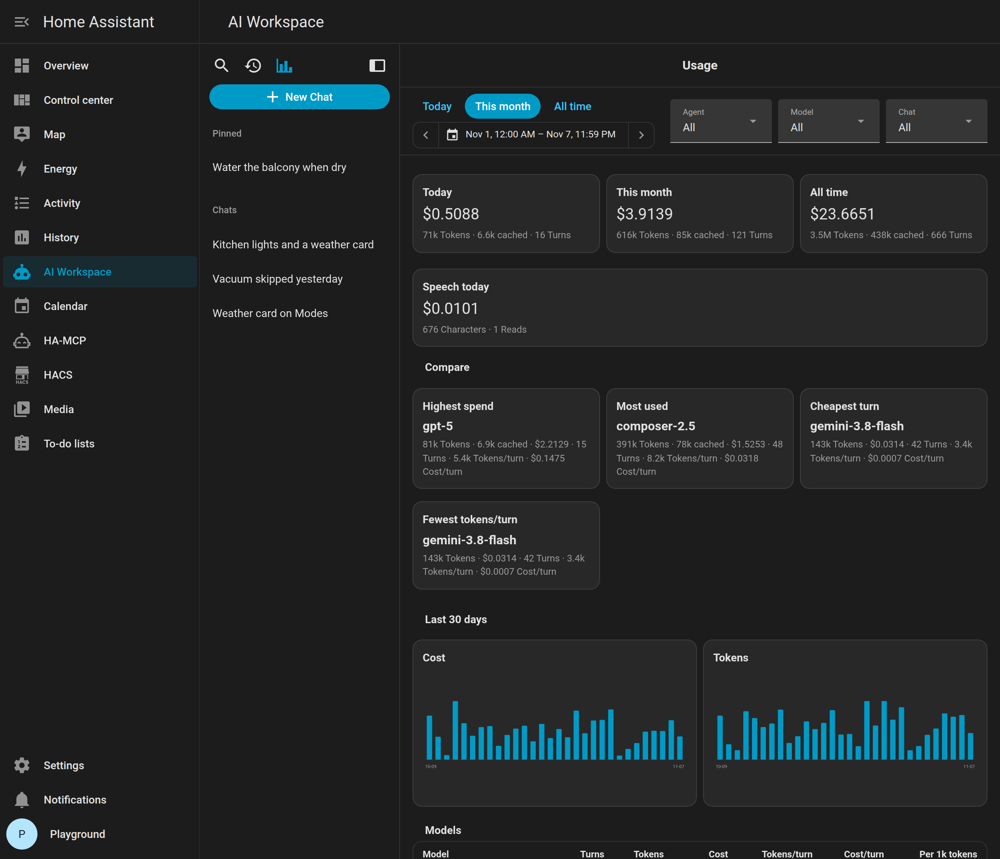

# Cost and tokens

**Track usage and costs** (on by default) records tokens and estimated cost in USD after each Cursor or cloud reply, including Assist. The sidebar **Usage** button opens `/ai-workspace/usage`: today / month / all-time totals, filters for agent, model, existing chat, and date, 30-day cost and token charts, and a model comparison (tokens per turn, cost per turn, highest spend, most used, cheapest turn).

**Show cost in chat header** (on by default) puts a short usage line under the chat title. Turn it off if you only want the Usage page.

Off on **Track usage and costs** stops new records. Existing history stays. Deleting a chat removes the messages, not the usage: the provider already billed that turn, so it stays on the Usage page.

## Where prices come from

The cost math is a small version of what [LiteLLM](https://github.com/BerriAI/litellm) does. LiteLLM is an open-source project that keeps a community-maintained list of list prices for thousands of models: input, output, cache read, and cache write per token. AI Workspace keeps a copy with only the providers it supports. A weekly job refreshes it, so new models and price changes arrive with the next update of AI Workspace.

For each reply, AI Workspace multiplies the tokens the provider reports by those prices. Cached input is priced at the cache rate, and reasoning tokens count as output. Cursor and local models are not in LiteLLM's list. Cursor uses the billed amount when your account reports it and an estimate otherwise. Local models count as $0.

The result is an estimate based on public list prices. Your provider's invoice is what counts: discounts, free tiers, taxes, and minimum charges are not included. Anthropic Console is a different pile of traffic: every API key and product in the organization, and it never drops a turn because you deleted a chat. AI Workspace is only its own turns. Deleting a chat used to remove those turns from the Usage page; that is fixed, but turns already deleted that way cannot be added back.

## What is counted

- **Cursor:** token counts come from the SDK. If the Cursor account exposes billed cents, that amount is stored as the cost. Otherwise the list-price estimate for Composer is used.
- **Cloud agents:** prompt and completion tokens from the provider, including cache and reasoning when they send them. Cost is list price (OpenAI, Anthropic, Gemini, DeepSeek, Qwen, Grok, Azure, OpenRouter, compatible). OpenRouter’s reported cost is used when it is present. Ollama is stored as $0.
- **Text-to-speech:** when an AI Workspace voice is used (Assist, overlay speaker, auto-read). OpenAI-style engines are priced per character (`gpt-4o-mini-tts`, `tts-1`, and `tts-1-hd`). Gemini TTS is priced from the audio tokens Google reports. Piper and other Home Assistant engines are not billed here. Speech-to-text (OpenAI transcribe or Gemini) is not stored on this page.
- Unknown models still store tokens. Cost stays empty until the price list knows that model name.

## Home Assistant sensors

**Add Home Assistant usage sensors** is off by default. The Usage page does not need them.

Turn it on if you want cost, token, and turn entities on your own Lovelace dashboards. You then get a device **AI Workspace** under **Usage**, plus sensors on each agent: cost / tokens / turns for today, this month, and total, last turn, and speech cost today / total. Home Assistant also fires `ai_workspace_usage` after every recorded turn.

Turn the option off again to remove those sensors. Tracking can stay on.

## Why a house question costs more than it looks

Cloud AI and Ollama send the system prompt and a **tool list** with each request. Each tool call adds its result and one more request, which sends the prompt and the tool list again. A greeting or thanks is sent without tools.

All of HA-MCP's tools come to about 38,000 tokens. Cloud agents therefore start with a smaller set: the search, state, and device control tools, the groups your message is about (for example the dashboard tools when you mention a card), and the groups this chat already used. The agent sees the names of the other tools and loads a group when it needs it. A typical request then carries 5,000–10,000 tokens of tools. Tools from MCP servers that do not group their tools are always sent. To send every tool again, set `tools_on_demand: false` in YAML.

A typical house-check turn on **Off** is often around **$0.40**. A long thread with many tool rounds can reach **$0.90+**. Most of that is the tool list and tool results as input, not your last sentence.

- Earlier messages are sent again so the model remembers the thread, up to a share of the model's context window (see the History column below). Long replies are no longer cut at 2,000 characters; only a message that would take more than about a third of the history keeps just its start and end. Each earlier reply carries a one-line note of the tools it used and what they returned, so the agent does not look everything up again.
- When a chat outgrows that share, the oldest turns are left out six at a time and replaced by a short summary of what was asked. Because the history only moves in steps, the provider's prompt cache keeps working on long chats.
- **[Look at Home Assistant first](settings.md#always-check-the-house-first):** a question that needs no house data, like a poem, still costs one tool call and one more request.
- **To spend less:** pick a smaller model for everyday questions, set **Reduce token usage** (below), disable the device of an MCP connection you do not need, and start a new chat when the topic changes.

## Reduce token usage

Set on each agent, Cursor included: **Off**, **Light**, **Medium**, or **Extreme**. Older versions had one setting for all agents; updating copies it onto every cloud agent.

The expensive part is the MCP tool list (and extra tool rounds), not the chat history. That is why Medium still costs a large share of Off, and Extreme is the only mode that usually saves most of a house-check turn.

| Mode | Tools | History | Prompt | Typical save vs Off on a house-check turn |
| --- | --- | --- | --- | --- |
| **Off** | Yes | 15% of the window, at most 24,000 tokens | Full | — |
| **Light** | Yes | 8% of the window, at most 8,000 tokens | Full | About **5–20%**. Skips extras such as auto-title, page context, and effort. |
| **Medium** | Yes | 3% of the window, at most 2,000 tokens | Short, tools allowed | About **25–45%**. |
| **Extreme** | No | None | Two sentences; cannot control the house | About **80–95%**. |

The context window comes from the model id (for example 400,000 tokens for GPT-5, 200,000 for Claude, 1,000,000 for Gemini, 32,000 for unknown Ollama models, otherwise 128,000). Set `context_window: <tokens>` in YAML if your model reads less, such as a small local model.

Light still attaches files and images; Medium and Extreme do not. Medium and Extreme also shorten a very long message and cap how long the reply can be.

**Look at Home Assistant first** is a separate switch on the agent and works on every level except Extreme (no tools). Leaving it on adds one tool round to house questions.

**Cursor:** the same levels apply. A Cursor agent that is still running keeps its own thread. A new one gets the earlier turns with the same budget and summary as cloud agents, with line breaks kept, so YAML and code from earlier in the chat arrive intact. Medium and Extreme start a new Cursor agent every turn, so Cursor's own thread cannot grow. Cursor always gets every tool; it manages the tool list itself. Extreme gives Cursor no tools at all. Cursor cannot cap the reply length, so the short prompts ask for short answers instead.

Use Extreme for a small local model or cheap Q&A; Medium when the agent should still call MCP; Off when you want the full product.

## Prompt cache

Separate from **Reduce token usage**. Token modes change *what* is sent. Prompt cache discounts the *same* prefix when it repeats — the system prompt and the MCP tool list on every round of a turn. It is **on** by default and not shown on Configure. Set `prompt_cache: false` in YAML only if you need to compare uncached cost.

After the first round of a house-check turn, later rounds *read* that prefix at about **10%** of the input price. The first write still costs a little more than uncached input (Claude’s 5-minute cache is about **1.25×**). Combined with Extreme you skip the tools; combined with Off you keep house control at a fraction of that ~$0.40 turn.

Claude reports uncached input, cache reads, and cache writes as separate counters. The Usage page adds those together so a house-check does not look like a few thousand tokens while the bill is hundreds of thousands. Dollars stay a list-price estimate: cache makes the *price per token* knowable, not a match to Anthropic’s invoice (5-minute vs 1-hour cache, contract rates, other keys).

Cursor and Ollama ignore this. Local Ollama is not billed per token here.

| Provider | What happens |
| --- | --- |
| **Claude** (including Claude on OpenRouter) | Caching is explicit. AI Workspace marks the tool list and system prompt (about five minutes). |
| **OpenAI / Azure / GPT via OpenRouter** | Prefixes over about 1,024 tokens are often cached automatically. A stable cache key lets hits work across chats for the same agent. |
| **Ollama** | Nothing. Ignored. |

Cache read and write tokens show up on the Usage cards when the provider reports them. If a provider rejects the extra cache fields, the request is retried without them for the rest of that agent session.
