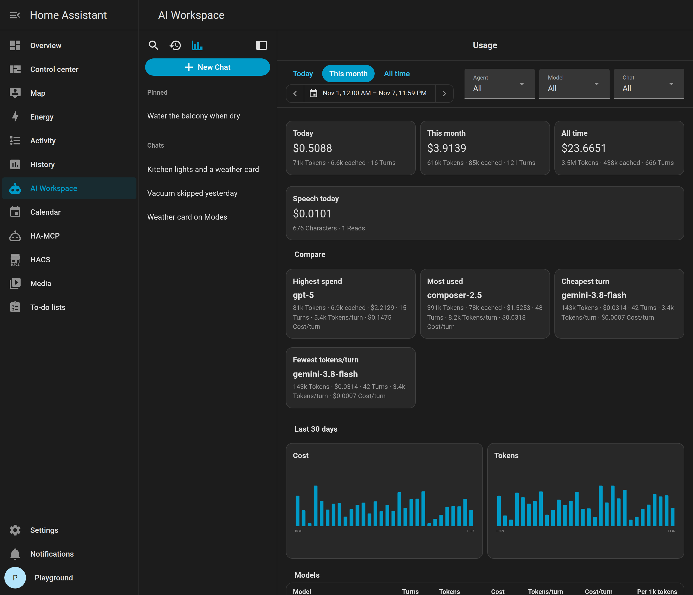

# Cost and tokens

**Track usage and costs** (on by default) records tokens and estimated cost in USD after each Cursor or cloud reply, including Assist. The sidebar **Usage** button opens `/ai-workspace/usage`: today / month / all-time totals, filters for agent, model, existing chat, and date, 30-day cost and token charts, and a model comparison (tokens per turn, cost per turn, highest spend, most used, cheapest turn).

**Show cost in chat header** (on by default) puts a short usage line under the chat title. Turn it off if you only want the Usage page.

Off on **Track usage and costs** stops new records. Existing history stays. Deleting a chat removes the messages, not the usage: the provider already billed that turn, so it stays on the Usage page.

## Where prices come from

The cost math is a small version of what [LiteLLM](https://github.com/BerriAI/litellm) does. LiteLLM is an open-source project that keeps a community-maintained list of list prices for thousands of models: input, output, cache read, and cache write per token. AI Workspace keeps a copy with only the providers it supports. A weekly job refreshes it, so new models and price changes arrive with the next update of AI Workspace.

For each request to the model, AI Workspace multiplies the tokens the provider reports by those prices. Cached input is priced at the cache rate, and reasoning tokens count as output. A turn with tool calls is several requests, and each is priced on its own: some models charge more for a long request (Gemini Pro above 200,000 input tokens, GPT-5.4 above 272,000), and that higher rate is used only for the requests that are that long. Claude cache writes kept for an hour are priced at their own rate (about 2× input). If you stop a turn or it fails partway, the requests that already finished are still counted. Cursor and local models are not in LiteLLM's list. Cursor uses the billed amount when your account reports it and an estimate otherwise. Local models count as $0.

The result is an estimate based on public list prices. Your provider's invoice is what counts: discounts, free tiers, taxes, and minimum charges are not included. Anthropic Console is a different pile of traffic: every API key and product in the organization, and it never drops a turn because you deleted a chat. AI Workspace is only its own turns. Deleting a chat used to remove those turns from the Usage page; that is fixed, but turns already deleted that way cannot be added back.

## What is counted

- **Cursor:** token counts come from the SDK. If the Cursor account exposes billed cents, that amount is stored as the cost. Otherwise the list-price estimate for Composer is used.
- **Cloud agents:** prompt and completion tokens from the provider, including cache and reasoning when they send them. Cost is list price (OpenAI, Anthropic, Gemini, DeepSeek, Qwen, Grok, Azure, OpenRouter, compatible). OpenRouter’s reported cost is used when it is present. Ollama is stored as $0.
- **Text-to-speech:** when an AI Workspace voice is used (Assist, overlay speaker, auto-read). OpenAI-style engines are priced per character (`gpt-4o-mini-tts`, `tts-1`, and `tts-1-hd`). Grok (xAI) TTS is priced per character ($4.20 per million, xAI's beta price). Gemini TTS is priced from the audio tokens Google reports. Piper and other Home Assistant engines are not billed here. Speech-to-text (OpenAI transcribe or Gemini) is not stored on this page.
- Unknown models still store tokens. Cost stays empty until the price list knows that model name.
- **Coding workers (Agent Worker / Cursor Worker over MCP):** when a chat agent hands a task to a worker (`agent_run`, then `agent_job`; older `cursor_agent` / `cursor_job`), the worker reports what its own engine used once the job is finished (succeeded, failed or cancelled). That usage is stored as its own row under **Worker: Claude Code**, **Worker: OpenAI Codex** or **Worker: Cursor** (agent id `worker:<engine>`), not added to the chat agent's turn. Each job is counted once, however often the agent polls it. Cost: Cursor billed cents when present, else the cost the engine reports itself (Claude Code), else list price when the model is known. Codex reports no price and usually no model, so its tokens are stored with the cost unknown.

## Plan limits

The **Plan limits** block shows how much of a subscription plan (Claude plan, Cursor, Codex) is used: the 5-hour session window and the 7-day week window in percent, when each resets, and when that was last seen. It is not token cost.

- **Claude plan (Claude SDK agents with a Plan token or Sign in with Claude):** Claude Code reports the plan's utilization with each turn (`rate_limit_event`; first answer of a turn and whenever a rounded percent changes). The Runtime stores the newest values (`plan_quota.json` in its data folder) and sends them to Home Assistant, which keeps the last state. If a turn brought no numbers, the Runtime reads them once from Anthropic's usage endpoint, the same one Claude Code's `/usage` uses (`GET /api/oauth/usage`, no model call, no quota), at most every 10 minutes. Tokens from `claude setup-token` may not be allowed to read it; then only the chat's numbers count. `CLAUDE_PLAN_USAGE_READ=off` on the Runtime switches the read off.
- **Below the warning threshold – no detailed numbers** means Claude reported its status (allowed) without percentages.
- When a window has reset since the last reading, the row says so instead of showing an old percentage.
- The chat shows a short hint once when a plan crosses into its warning zone, and a translated message with the reset time when the limit is reached.
- Anthropic API keys have no plan limits; their row stays empty.

## Home Assistant sensors

**Add Home Assistant usage sensors** is off by default. The Usage page does not need them.

Turn it on if you want cost, token, and turn entities on your own Lovelace dashboards. You then get a device **AI Workspace** under **Usage**, plus sensors on each agent: cost / tokens / turns for today, this month, and total, last turn, and speech cost today / total. The cost, token and turn sensors of the **AI Workspace** device carry a `workers` attribute with the worker jobs of that window per engine (`worker:claude`, `worker:codex`, ...). Home Assistant also fires `ai_workspace_usage` after every recorded turn.

Turn the option off again to remove those sensors. Tracking can stay on.

## Why a house question costs more than it looks

Cloud AI and Ollama send the system prompt and a **tool list** with each request. Each tool call adds its result and one more request, which sends the prompt and the tool list again. A greeting or thanks is sent without tools.

All of HA-MCP's tools come to about 38,000 tokens. Cloud agents therefore start with a smaller set: the search, state, and device control tools, the groups your message is about (for example the dashboard tools when you mention a card), and the groups this chat already used. The agent sees the names of the other tools and loads a group when it needs it. A typical request then carries 5,000–10,000 tokens of tools. Tools from MCP servers that do not group their tools are always sent. To send every tool again, set `tools_on_demand: false` in YAML.

A typical house-check turn on **Off** is often around **$0.40**. A long thread with many tool rounds can reach **$0.90+**. Most of that is the tool list and tool results as input, not your last sentence.

- Earlier messages are sent again so the model remembers the thread, up to a share of the model's context window (see the History column below). Long replies are no longer cut at 2,000 characters; only a message that would take more than about a third of the history keeps just its start and end. Each earlier reply carries a one-line note of the tools it used and what they returned, so the agent does not look everything up again.
- When a chat outgrows that share, the oldest turns are left out six at a time and replaced by a short summary of what was asked. Because the history only moves in steps, the provider's prompt cache keeps working on long chats.
- **[Looking at Home Assistant first](settings.md#always-check-the-house-first):** a question about the house always starts with one tool call. Greetings and thanks do not.
- **To spend less:** pick a smaller model for everyday questions, turn on **Save tokens** (below), disable the device of an MCP connection you do not need, and start a new chat when the topic changes.

## Save tokens

Every agent, Cursor included, has one box under **Advanced**: **Save tokens**. It is off by default, which gives the most reliable answers about your home.

| | Tools | History | Prompt | Replies |
| --- | --- | --- | --- | --- |
| **Off** (default) | Loaded on demand | 15% of the context window, at most 24,000 tokens | Full | Full length |
| **Save tokens** | Loaded on demand, shorter descriptions | 3% of the window, at most 2,000 tokens | Short | Capped; long messages are shortened |

With Save tokens, files and images are not attached, and extras such as auto titles and page context are skipped. A house-check turn usually costs about 25–45% less.

**Agents on the AI Workspace Runtime** (Cursor, Claude SDK) get the short prompt and the shorter history too. Replies are not capped there, and the agent's **Effort** still applies.
- **Claude SDK** keeps its session while it is small, so Claude remembers its own tool results and reuses the cached start of the chat. Once a turn's context reaches about 40,000 tokens, the next turn starts a new session that gets the recent history from Home Assistant. A session the Runtime has not measured yet, for example after a restart, also starts new. With Save tokens off, the session simply continues.
- **Cursor** keeps its agent for 4 turns, then starts a new one with the recent history. Cursor reports tokens per turn summed over all its model calls, so the size of its context cannot be measured and turns are counted instead. With or without Save tokens, a Cursor chat idle for 2 minutes gets a new agent.

The context window comes from the model id (for example 400,000 tokens for GPT-5, 200,000 for Claude, 1,000,000 for Gemini, otherwise 128,000). For Ollama, AI Workspace asks Ollama itself. Set `context_window: <tokens>` in YAML to override it.

**Chat only.** An agent without tools can answer questions but cannot check or change your home. AI Workspace switches to chat only by itself when an Ollama model cannot use tools, or when Ollama runs it with a context window too small for them, and says so once in the chat. To force chat only, set `low_token: extreme` on the agent in YAML. Agents that used **Extreme** before 1.5 stay chat only while **Save tokens** stays on. Chat only remembers the last few messages.

**Cursor:** the same box applies. A Cursor agent that is still running keeps its own thread. A new one gets the earlier turns with the same budget and summary as cloud agents, with line breaks kept, so YAML and code from earlier in the chat arrive intact. With Save tokens, every turn starts a new Cursor agent, so Cursor's own thread cannot grow. Cursor always gets every tool; it manages the tool list itself. Cursor cannot cap the reply length, so the short prompt asks for short answers instead.

Before 1.5 there were four levels. **Light** now counts as Off: on-demand tools and the history budget made Off cheaper than Light used to be. **Medium** is Save tokens.

## Prompt cache

Separate from **Save tokens**, which changes *what* is sent. Prompt cache discounts the *same* prefix when it repeats — the system prompt and the MCP tool list on every round of a turn. It is **on** by default and not shown on Configure. Set `prompt_cache: false` in YAML only if you need to compare uncached cost.

After the first round of a house-check turn, later rounds *read* that prefix at about **10%** of the input price. The first write still costs a little more than uncached input (Claude’s 5-minute cache is about **1.25×**). With Off you keep house control at a fraction of that ~$0.40 turn.

Claude reports uncached input, cache reads, and cache writes as separate counters. The Usage page adds those together so a house-check does not look like a few thousand tokens while the bill is hundreds of thousands. Dollars stay a list-price estimate, not a match to Anthropic’s invoice (contract rates, other keys).

**Keep the cache for an hour** (Claude agents, under **Advanced**, off by default). Claude forgets a cached prompt after 5 minutes. In a house chat the next message often comes later than that, so the system prompt and tool list are written to the cache again at 1.25× instead of read at 0.1×. With the box on, the system prompt and tools stay cached for an hour; a cache write then costs 2× input. That pays off when your messages are more than 5 minutes but less than an hour apart, which is typical for a house chat. If you use the agent only once in a while, leave it off. The chat history after the tools keeps the 5-minute cache. If Anthropic refuses the 1-hour cache, AI Workspace falls back to 5 minutes.

Cursor and Ollama ignore this. Local Ollama is not billed per token here.

| Provider | What happens |
| --- | --- |
| **Claude** (including Claude on OpenRouter) | Caching is explicit. AI Workspace marks the tool list and system prompt (five minutes, or an hour with **Keep the cache for an hour** on a Claude agent). |
| **OpenAI / Azure / GPT via OpenRouter** | Prefixes over about 1,024 tokens are often cached automatically. A stable cache key lets hits work across chats for the same agent. |
| **Ollama** | Nothing. Ignored. |

Cache read and write tokens show up on the Usage cards when the provider reports them. If a provider rejects the extra cache fields, the request is retried without them for the rest of that agent session.
