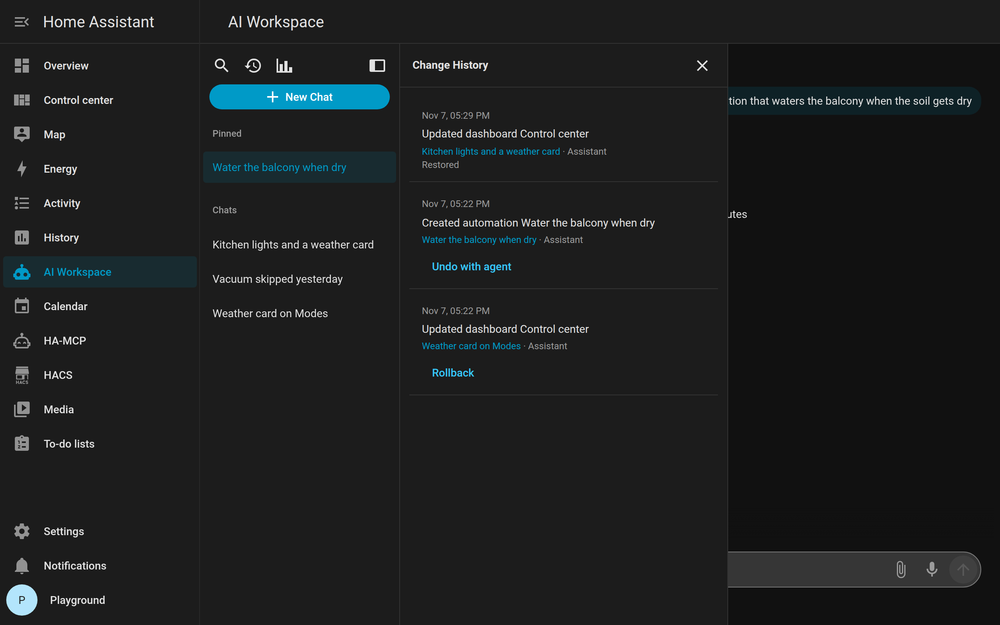

# MCP and Change History

What the agent can do depends on the MCP server you connect. AI Workspace can use more than one connection at a time. Disable a connection’s device to drop its tools without deleting it.

See [How it is organized](settings.md#how-it-is-organized) for connections vs agents.

## How tools reach Home Assistant

Cloud agents (OpenAI, Claude, and the others) call MCP from inside Home Assistant.

Cursor is different: the model runs in the Cursor runtime next to Home Assistant, and tools go through that runtime. You do not point Cursor at your MCP URL yourself; AI Workspace does that when you chat.

## HA-MCP inside Home Assistant

When the HA-MCP integration runs inside Home Assistant, AI Workspace finds it by itself and follows its settings (HA-MCP Server → Configure):

| HA-MCP setting | Address AI Workspace uses |
| --- | --- |
| Remote access via webhook **on**, authentication **Secret webhook URL** | The webhook, then HA-MCP's direct address |
| Remote access via webhook **off** (local only) | HA-MCP's direct address (port 9584 by default) |
| Authentication **Sign in with Home Assistant** | The direct address first. On the webhook, AI Workspace signs in as the chatting user, and HA-MCP only lets in administrators. |
| Authentication **OAuth (legacy)** | Only the direct address. AI Workspace cannot use the legacy client id and secret. |

A saved HA-MCP connection that no longer answers moves to a working address after Home Assistant starts. If HA-MCP still fails, the log line "MCP connection … skipped" says what to change in HA-MCP.

## Shorten long Home Assistant answers

On by default, for cloud agents and Cursor.

A whole-home entity list or a big search is a lot of JSON. Sending all of it to the model burns tokens and can make replies slower. With this on, large **entity listings** are condensed **before the model reads them**:

- A huge listing becomes entity ids grouped by area. The model can ask again for one area or one entity.
- A shorter listing keeps each entity’s state and drops bulky attributes.

Everything else reaches the model exactly as Home Assistant or the MCP server sent it: guides, dashboards, automations, scripts, and single entities. That matters because the model may write those values back, and HA-MCP puts the key it needs for dashboard writes in its guide.

A result over 100,000 characters first has its longest texts shortened, for example one huge notification inside HA-MCP's system overview. Every other part stays, the JSON stays valid, and each shortened text says where it came from (such as the notification or entity id), so the agent can tell you which integration or device makes answers that large. Only when that is not enough is the result cut at the end, with a note that it is incomplete, must not be written back, and should be asked for in smaller parts.

The setting lives in AI Workspace → Configure. The integration sends it to the Cursor runtime with every chat, so the Runtime App and the Docker image have no setting of their own for it.

Turn this off if you want every attribute of a large listing in one shot and you accept the extra tokens.

## Change History

On by default, for cloud agents and Cursor.

This is a **log** of configuration writes the agent actually made (the last 30). Open it from the sidebar. Each row has one way back. **Rollback** puts back the snapshot Change History took before that write — that works without HA-MCP and without the agent. A row with no snapshot, such as something the agent created, shows **Undo with agent** instead: it sends the change details to the chat, and the agent undoes it with the tools it actually has (for example deletes what it created, or uses an HA-MCP backup from before the change). If Rollback fails, the error offers Undo with agent too. Rollback and Undo with agent are for administrators. Rollback goes through Home Assistant's own APIs signed in as you, the same calls the automation, helper, and dashboard editors make, so Home Assistant checks and stores the item itself.

**Rollback for** (default 7 days, Configure or `change_history_ttl_days`) hides Rollback and Undo with agent on older rows. The log stays. An old dashboard snapshot would otherwise overwrite later cards and entities. Use 1 for about a day.

### If Home Assistant will not start

A bad automation, script, or scene can stop Home Assistant from booting, so the sidebar **Rollback** is gone. Change History also writes a YAML copy for those three kinds:

`config/ai_workspace/changes/{id}.yaml`

The file starts with a comment: when it was taken, which chat, and which Home Assistant file to merge into (`automations.yaml`, `scripts.yaml`, or `scenes.yaml`).

1. Stop Home Assistant.
2. Open `config/ai_workspace/changes/` (the `config` folder next to `configuration.yaml`).
3. Pick the snapshot that matches the change (newest files are usually last). Read the comment at the top.
4. In that Home Assistant YAML file, replace the item with the **same id**. Automations and scenes are a list of documents; scripts are a map keyed by id. Do not paste the comment lines into the live file.
5. Start Home Assistant. If it still will not start, the YAML is invalid: check quotes and indentation, or restore from a Home Assistant backup.

Dashboards, helpers, and entity-registry edits are in `config/ai_workspace/ai-workspace.sqlite`, not in `changes/`. Those rarely block startup. Use **Rollback** in the UI once Home Assistant is up, or restore a Home Assistant backup.

The folder keeps files for the last 30 recorded writes. Hiding Rollback after a few days does not delete them. Several YAML writes in one agent reply share one `{id}.yaml`; the file is the last of those writes.

Turn **Change History** off if you do not want snapshots. The agent can still use Home Assistant; only the log stops.

## Built-in MCP Server vs the connection row

The built-in Home Assistant MCP Server needs **All LLM APIs** and the **MCP Server** integration loaded. Turning those off hides its tools even if the AI Workspace connection row is still there. That is not the same as disabling the AI Workspace device.
